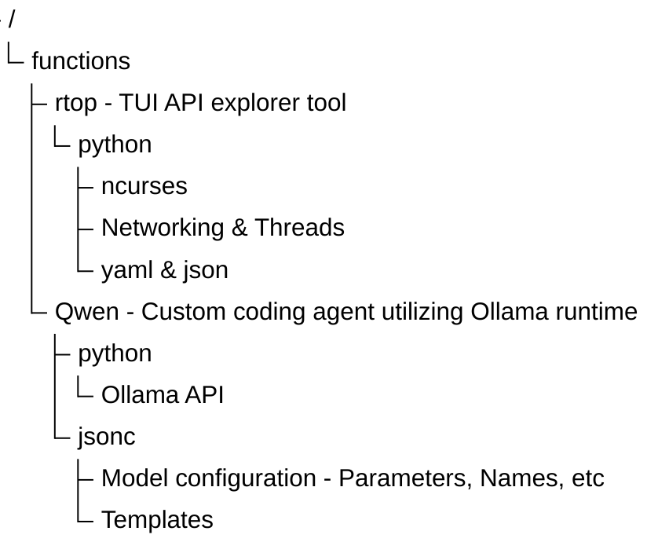

```text
░▒▓███  ░▒▓███  ░▒▓███  ░▒▓███   ░▒▓███  ░▒▓   ██ ░█ ░▒▓█████ ░▒▓████
░▒▓     ░▒▓  ██ ░▒▓  ██ ░▒▓  ██ ░▒▓   ██ ░▒▓█  ██ ░█    ░▓█   ░▒▓     
░▒▓     ░▒▓████ ░▒▓███  ░▒▓███  ░▒▓   ██ ░▒▓ █ ██ ░█    ░▓█   ░▒▓███  
░▒▓     ░▒▓  ██ ░▒▓  ██ ░▒▓  ██ ░▒▓   ██ ░▒▓  ███ ░█    ░▓█   ░▒▓     
 ░▒▓███ ░▒▓  ██ ░▒▓  ██ ░▒▓███   ░▒▓███  ░▒▓   ██ ░█    ░▓█   ░▒▓████

CARBONITE(1)                  User Manuals                  CARBONITE(1)

NAME
       carbonite - backend & security developer, terminal enthusiast

SYNOPSIS
       carbonite [--read-the-docs] [--no-shortcuts] [backend|security|tui]

DESCRIPTION
       Focused on backend architecture, security tooling, and terminal
       interfaces built with ncurses. Approaches engineering by reading
       official specifications and documentation from the ground up—using
       Python, automation, and AI intentionally rather than as a substitute
       for understanding how systems actually work.

STACK & TECHNOLOGIES
      Experienced in working and exploring different technologies and methods
      as part of resolving issues and creating issue.

      ┌──────────────────┬───────────────────────────────────────────────────┐
      │ DOMAIN           │ TOOLS & TECHNOLOGIES                              │
      ├──────────────────┼───────────────────────────────────────────────────┤
      │ Backend & APIs   │ [ Python ] FastAPI, Flask, RenderAPI, Google APIs |
      │ Terminal         │ [ Python, C ] ncurses, rich                       |
      │ Security         │ Burpsuite, PostMan, Nmap, Dirbuster, ...          |
      │ Data & Infra     │ Docker                                            │
      └──────────────────┴───────────────────────────────────────────────────┘

FUNCTIONS
```

